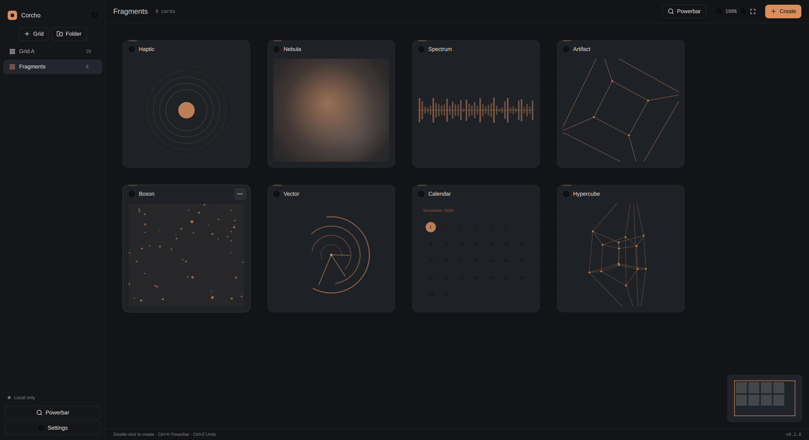
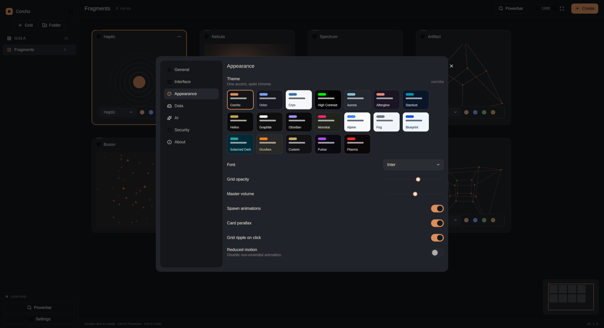

# Corcho

A native desktop workspace where notes, sites, tasks and calendars share
one infinite grid. Built with **Rust** and **Qt 6** (Qt Quick and QtWebEngine),
for Linux. No Electron shell, no telemetry, no analytics.





## Features

- Infinite grid with pan, zoom, snapping, a minimap and undo/redo.
- Fourteen card types: note, website, bookmark, API data, AI node, script,
  calendar, timbre, grid portal, checklist, kanban, whiteboard, pomodoro and
  now playing.
- Multi-calendar planning: add reminders, link dates from kanban, checklists
  and any other card, then filter the calendar view per calendar.
- A dedicated Timbre card for noise and pure-tone audio, with volume, pitch
  and mix controls.
- Custom SVG icons for every grid, plus a guided Git sync setup wizard.
- Themes follow the system light/dark appearance, with a separate theme chosen
  for light and dark.
- Five AI providers (Anthropic, OpenAI, Google, xAI and Mistral) plus a local
  OpenAI-compatible server, with streaming and context injection.
- Isolated website sessions, a host-based ad blocker and a cross-origin
  session probe.
- Folder, Google Drive and **git sync** to any remote (GitHub, Codeberg,
  GitLab or self-hosted). Sync pulls at start, pushes after a short debounce
  and union-merges so a grid or card is never dropped. Conflict copies stay
  in `backups/`.
- Stable, beta and experimental update channels, MPRIS, scripts, launch at
  startup and a `corcho://` protocol handler. Every feature is free.
- A complete **MCP server** over stdio or local HTTP: workspace, grids,
  folders, every card type, calendars and date links, viewport and frame
  queries, card visibility, settings, AI, web fetch/DOM/screenshot, git, sync,
  backups and updates. See [`docs/MCP.md`](docs/MCP.md).

## Palette

Two base neutrals and one accent, following the 60-30-10 rule.

| Role | Color | Share |
| --- | --- | --- |
| Base 1: ink (canvas, chrome) | `#121417` | 60% |
| Base 2: paper (text, light surfaces) | `#ECE7DE` | 30% |
| Accent: ember (actions, selection) | `#D98E5C` | 10% |

Surfaces derive from the ink base (`#1B1E23`, `#272B31`). Borders use the
paper tone at 9% alpha, and semantic colours are muted (success `#7FAE83`,
danger `#D97A72`). The accent is reserved for the primary action, the current
selection and one highlighted figure.

The 60-30-10 rule and the "two neutrals plus one accent" guidance come from
[Color Scheme Calculator](https://colorschemecalculator.com/create-color-palette/)
and [Sky Rye Design](https://skyryedesign.com/inspiration/color-palette-inspiration/).

## Accessibility

Contrast targets, focus behaviour and reduced-motion rules are documented in
[docs/ACCESSIBILITY.md](docs/ACCESSIBILITY.md).

## Build

Requires Rust 1.85 or newer, Qt 6.8+ development packages (Core, Gui, Qml,
Quick, QuickControls2, Svg, WebEngine and Network) and ALSA headers.

```sh
QMAKE=/usr/bin/qmake6 cargo build
QMAKE=/usr/bin/qmake6 cargo run
```

The build is Cargo-only; CMake is not required.

Run the checks:

```sh
cargo fmt --check
QMAKE=/usr/bin/qmake6 cargo clippy --all-targets -- -D warnings
QMAKE=/usr/bin/qmake6 cargo test
```

The release binary is about 11 MB. Full implementation status, including known
limits, is in [PLAN.md](PLAN.md).

## Install

The build is a single binary plus a desktop entry and icon. To install for the
current user:

```sh
install -m755 target/release/corcho ~/.local/bin/corcho
install -m644 packaging/corcho.desktop ~/.local/share/applications/
install -m644 packaging/corcho.svg ~/.local/share/icons/hicolor/scalable/apps/
update-desktop-database ~/.local/share/applications
xdg-mime default corcho.desktop x-scheme-handler/corcho
```

Packaging scripts for Debian, AppImage and Flatpak live in
[`packaging/`](packaging/).

## MCP

```sh
corcho --mcp                              # stdio
corcho --mcp-http 127.0.0.1:7411          # local HTTP with a bearer token
```

The HTTP token is written to `~/.local/share/corcho/mcp.token` with mode 0600.
Tools, resources and prompts are listed in [docs/MCP.md](docs/MCP.md).

## Data

`~/.local/share/corcho/workspace.json` holds the workspace. The
`attachments/`, `backups/` and `updates/` directories sit beside it.

## Acknowledgements

Corcho is an independent native implementation inspired by the ideas in
[Spacesuit](https://spacesuit.lightmode.io/). It is not affiliated with or
endorsed by Lightmode Laboratories, and it shares no code or branding with
that project.

The interface polish follows the [unslop](https://github.com/heydamir/unslop)
method by Damir Sokolovsky ([@heydamir](https://x.com/heydamir)), licensed
under CC BY 4.0.

## License

MIT. See [LICENSE](LICENSE). Bundled Inter fonts are under the SIL Open Font
License; Lucide icons are ISC.
